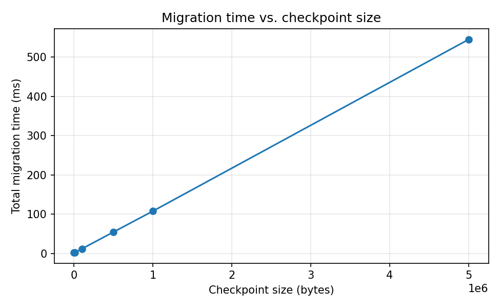

# Grid-Aware AI Workload Mobility

A proof-of-concept middleware for exploring grid-aware workload placement
and simulated mobility across an edge–cloud continuum. It uses
synthetic, configurable grid signals (renewable share, electricity
price, and carbon intensity), basic API-key checks for selected
operations, and configurable migration time budgets.



## What this prototype does

- **Grid-aware placement.** A configurable weighted policy scores each
  candidate site using renewable ratio, electricity price, and carbon
  intensity, subject to hard constraints.
- **Simulated workload mobility.** A synthetic counter with bounded
  history and an injectable payload represents application state. The
  middleware performs actual JSON serialization and deserialization,
  simulates transfer delay using a configurable bandwidth model,
  verifies counter continuity, and updates workload routing. State
  remains centrally managed; no checkpoint is transferred to the target
  worker.
- **In-place model switching (simulated variants).** `small` and `large`
  are simulated model variants with different artificial execution
  delays. Switching happens at runtime without restarting the workload.
- **Time-budgeted transitions.** Each migration carries a `budget_ms`;
  exceeding it triggers an automatic rollback.
- **Basic API-key authentication and event logging.** Selected workload
  operations are guarded by demonstration-level API-key checks.
  Migration decisions and selected operational events are recorded in an
  in-memory log. This does not provide comprehensive authorization,
  tenant isolation, or end-to-end migration security.
- **Carbon-aware model selection.** The large model is only allowed on
  sites below a configurable carbon threshold.

## Architecture

```
        ┌──────────────────────────┐
        │   Middleware  :8000      │
        │  - Workload state        │
        │  - Grid policy           │
        │  - Migration engine      │
        │  - Policy / audit log    │
        │  - Metrics               │
        └───────┬──────────┬───────┘
                │          │
        HTTP    │          │  HTTP
                ▼          ▼
        ┌──────────┐  ┌──────────┐
        │ Edge     │  │ Cloud    │
        │ :8001    │  │ :8002    │
        │ stateless│  │ stateless│
        │ executor │  │ executor │
        └──────────┘  └──────────┘
```

The middleware owns all workload state; compute nodes are stateless
executors.

## API

| Method | Path | Purpose |
|---|---|---|
| GET  | `/health` | liveness |
| GET  | `/sites` | current grid signals |
| GET  | `/testbeds` | probe both compute nodes |
| POST | `/workloads` | create a workload |
| GET  | `/workloads/{id}` | read workload state |
| POST | `/workloads/{id}/infer` | run inference on the current site |
| POST | `/workloads/{id}/payload` | inject payload (scaling experiments) |
| POST | `/workloads/{id}/checkpoint` | export state as a JSON blob |
| POST | `/workloads/{id}/restore` | restore state from a blob |
| POST | `/workloads/{id}/migrate` | migrate (and optionally switch model) |
| POST | `/grid/signal` | update grid signal for a site |
| POST | `/grid/auto-migrate/{id}` | policy-driven migration |
| GET  | `/policy` / POST `/policy` | read / update grid policy |
| GET  | `/policy/log` | audit log |
| GET  | `/metrics` / `/metrics/summary` | counters and phase-level stats |

## Quick start

```bash
pip install -r requirements.txt

# terminal 1
uvicorn app.edge_node:app  --port 8001

# terminal 2
uvicorn app.cloud_node:app --port 8002

# terminal 3
uvicorn app.main:app       --port 8000
```

Or with Docker:

```bash
docker compose up --build
```

Verify both compute nodes are reachable:

```bash
curl http://127.0.0.1:8000/health
curl http://127.0.0.1:8000/testbeds
```

## Tests

```bash
pytest tests/ -v
```

Eight smoke tests passed, covering workload creation, simulated
migration, state preservation, budget-based rollback,
checkpoint/restore, API-key denial, and grid-aware placement.

## Benchmarks

### Policy comparison

```bash
python scripts/benchmark.py
```

Runs 3 policies × 2 start sites × 5 trials = 30 samples under the
current bandwidth-aware transfer model, and writes both a CSV and a
Markdown summary into `results/`. All reported numbers are derived
from the current run; nothing is hard-coded in the summary generator.

Sample result (budget 200 ms; edge 0.85 renewable / 0.20 €,
cloud 0.30 renewable / 0.10 €):

| Policy | Non-no-op | Cross-site | In-place | No-op | Avg (ms) |
|---|---:|---:|---:|---:|---:|
| Price-first | 5 | 5 | 0 | 5 | 2.99 |
| Carbon-first | 10 | 5 | 5 | 0 | 2.59 |
| Balanced | 10 | 5 | 5 | 0 | 2.54 |

Across 30 operations, 25 non-no-op transitions were observed,
including 15 simulated cross-site relocations and 10 in-place
model-variant switches. The mean transition time was 2.65 ms, with all
measured transitions completing within the 200 ms budget.

### Historical results (previous fixed-sleep model)

<details>
<summary>Click to expand</summary>

An earlier version of `_do_migrate` used fixed `time.sleep(0.02)` calls
instead of a bandwidth-aware model. That version reported ~50 ms per
migration regardless of state size:

| policy | real migrations | no-op | avg ms | target site |
|---|---|---|---|---|
| price_first  | 5  | 5 | 50.9 | cloud:5 |
| carbon_first | 10 | 0 | 50.7 | edge:10 |
| balanced     | 10 | 0 | 50.7 | edge:10 |

Historical results were obtained using an earlier simulation
configuration and should not be interpreted as measurements of real
network migration performance.

</details>

### Scaling experiment

```bash
python scripts/scaling_experiment.py
```

Measures migration latency vs. checkpoint size (0 → 5 MB) under the
same bandwidth-aware cost model, assuming a 10 MB/s edge–cloud link and
200 MB/s serialize/deserialize rate.

| checkpoint | migration time |
|---|---|
| 174 B   | ~2.7 ms |
| 10 KB   | ~2.9 ms |
| 100 KB  | ~12.1 ms |
| 500 KB  | ~54.8 ms |
| 1 MB    | ~108 ms |
| 5 MB    | ~545 ms |

Below ~10 KB, latency is dominated by fixed protocol overhead; above
~100 KB it scales linearly with checkpoint size at the expected link
rate (~0.1 ms per KB).

## Limitations

This is a research prototype, not a production orchestrator.

- **Authoritative state lives in the middleware.** Compute nodes are
  stateless. No checkpoint is transferred to the target worker; the
  target site field is updated and subsequent requests are routed
  accordingly. A production system would push state ownership to the
  workers, with a quiesce / checkpoint / restore / commit / rollback
  state machine and fencing tokens enforced on the request path.
- **The AI workload is synthetic.** A counter with bounded history and
  an injectable payload validates the routing and state-continuity
  logic, but not real model-internal state (KV cache, sliding windows).
- **Model variants are simulated.** `small` and `large` differ only in a
  fixed sleep duration; no real model is loaded or unloaded and no CPU,
  GPU, or memory consumption is measured.
- **Grid signals are synthetic and configurable**, not measured from a
  live grid. Energy savings on a real grid cannot be inferred from
  these experiments.
- **Migration cost is partly simulated.** Serialization and
  deserialization are real; the network hop is modelled as a
  fixed-bandwidth link.
- **Authentication is demonstration-level.** A single shared API key
  guards selected operations. There is no per-workload authorization,
  tenant isolation, or end-to-end security during migration.
- **No fault injection yet.** Node unreachable, transfer interrupted,
  corrupted checkpoint, and concurrent migration are future work.
- **Serialization format is JSON** for readability. Future work could
  evaluate binary serialization formats such as Protocol Buffers or
  MessagePack to assess checkpoint size and serialization overhead.

## Repository layout

```
.
├── app/
│   ├── main.py           # middleware: state, policy, migration engine
│   ├── edge_node.py      # edge executor  (:8001)
│   ├── cloud_node.py     # cloud executor (:8002)
│   ├── models.py         # pydantic schemas
│   └── policy.py         # grid-aware placement policy
├── scripts/
│   ├── benchmark.py           # policy comparison benchmark
│   └── scaling_experiment.py  # checkpoint-size scaling experiment
├── tests/
│   └── test_smoke.py     # 8 smoke tests
├── docs/
│   └── project_summary.tex
├── results/              # CSVs and PNGs produced by the scripts
├── Dockerfile
├── docker-compose.yml
├── requirements.txt
└── README.md
```